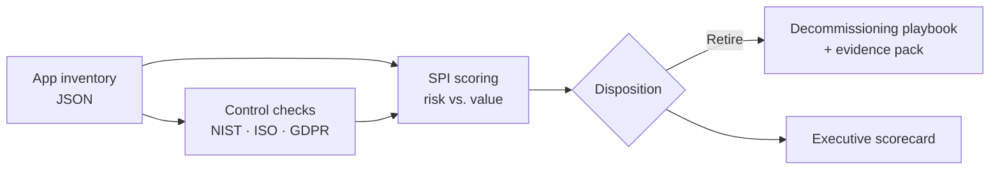

# NIST RMF Governance Engine: Application Sunset & Compliance

[](https://github.com/dawncreter/nist-rmf-governance-engine/actions/workflows/ci.yml)

This engine scores every application in a portfolio for security, cost, technical debt and regulatory exposure. It maps control gaps to **NIST SP 800-53 Rev. 5**, **ISO/IEC 27001:2022 Annex A** and **GDPR Art. 32**, and computes a **Sunset Priority Index (SPI)**. It then recommends Retire / Remediate / Modernize / Retain and generates an audit-ready decommissioning playbook.

> **Reference implementation** on a fictional 25-app inventory. It encodes the approach behind the application sunset standard I created at Deloitte, alongside the GDPR, NIST RMF, ISO 27001 and Veracode programs that cut platform vulnerability profiles 89% (see the [Deloitte case study](https://github.com/dawncreter/global-audit-platforms-case-study)). It is not Deloitte's code or data.

## Why it matters
Every legacy app still running is attack surface, licence cost and audit scope. Retiring the right apps is often the cheapest security control, but only if the decision is explainable to owners and auditors.

## How it works


| Control check | NIST SP 800-53 | ISO 27001 |
|---|---|---|
| Multi-factor authentication | IA-2(1) | A.8.5 |
| Audit logging | AU-2, AU-12 | A.8.15 |
| Encryption at rest (personal data) / in transit | SC-28 / SC-8 | A.8.24 |
| Access review ≤ 90 days | AC-2(3) | A.5.18 |
| Backups tested | CP-9 | A.8.13 |
| Criticals patched ≤ 30 days | SI-2 | A.8.8 |
| Vendor-supported components | SA-22 | A.8.8 |

### Sunset Priority Index
```text
risk  = 0.45·security + 0.15·technical_debt + 0.15·regulatory + 0.25·cost_per_user
value = 0.8·(criticality−1)/4 + 0.2·min(1, users/2000)
SPI   = 100·risk·(1 − 0.6·value) + 15·replacement_available      (capped at 100)

risk ≥ 0.5, value < 0.5   → Retire
risk ≥ 0.5, value ≥ 0.5   → Remediate (Modernize if a replacement exists)
risk < 0.5, value < 0.25  → Retire on cost
otherwise                 → Retain
```
Every number in the formula lives in `spi.py`, so governance teams can tune the weights and defend them.

## Demo
```text
$ sunset-engine scorecard
Applications assessed: 25 · Retire: 11 · Remediate: 2 · Modernize: 0 · Retain: 12
Retiring the recommended applications removes $2,767,700/yr in run cost and 29 critical vulnerabilities.

| SPI  | App              | Disposition | Risk | Value | Gaps                                   |
| 89.1 | Audit Workpapers | Retire      | 0.85 | 0.21  | IA-2(1), AU-2, AU-12, CP-9, SI-2, SA-22 |
…
$ sunset-engine playbook          # step-by-step decommissioning with data retention, AC-2, MP-6, CM-8, GDPR Art. 30
```

## Quick start
```bash
pip install -e ".[dev]"
sunset-engine scorecard
sunset-engine playbook APP-005
make test        # 14 tests, 100% branch coverage
```

## License
MIT
